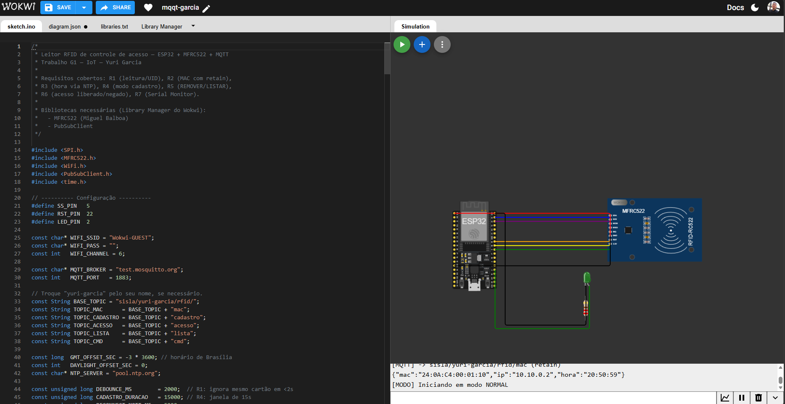
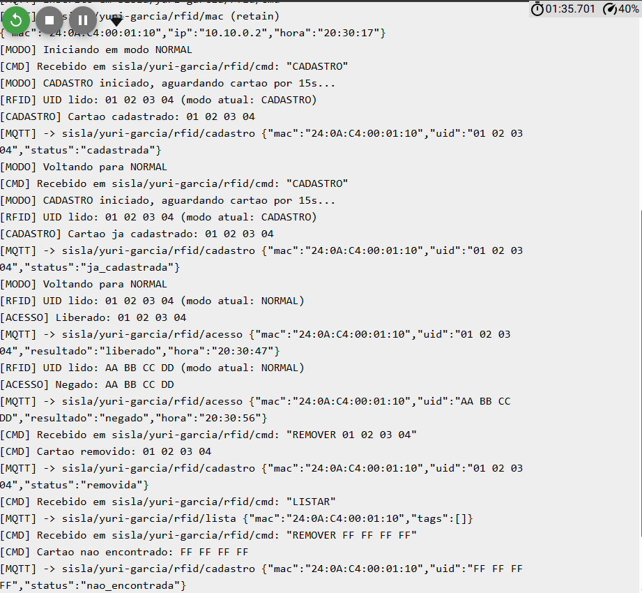

# ENTREGA — Leitor RFID de Controle de Acesso

**Nome:** Yuri Garcia\
**Disciplina:** IoT (Internet of Things)\
**Professor:** Prof. Leonam V. Hemann

## Link do projeto Wokwi

`https://wokwi.com/projects/476542947537617921`

Prefixo dos tópicos MQTT usado: `sisla/yuri-garcia/rfid/`

------------------------------------------------------------------------

## Diagrama de ligações

Print do editor Wokwi mostrando o código-fonte e o esquema de fiação entre
o ESP32 e o leitor MFRC522 (SDA→GPIO5, SCK→GPIO18, MOSI→GPIO23,
MISO→GPIO19, RST→GPIO22, 3V3 e GND), além do LED com resistor de 220 Ω no
GPIO2:

> 

------------------------------------------------------------------------

## Prints exigidos

Todos os testes abaixo foram validados via `mosquitto_sub -h test.mosquitto.org -t "sisla/yuri-garcia/rfid/#" -v`
rodando em paralelo à simulação. Os payloads reais capturados estão citados
junto de cada item

### Log consolidado do Serial Monitor

O print abaixo mostra, em sequência, a maior parte dos eventos exigidos —
cadastro, cadastro repetido, acesso liberado, acesso negado, remoção e
listagem — direto do Serial Monitor do Wokwi (que replica cada publicação
MQTT feita pelo ESP32):

> 

### 1. Mensagem retida em `.../mac`

*(visível também no canto inferior do print do diagrama de ligações, acima)*

> 

```json
Tópico: sisla/yuri-garcia/rfid/mac (RETAIN)
{"mac":"24:0A:C4:00:01:10","ip":"10.10.0.2","hora":"20:50:59"}
```

### 2. Cadastro

*(ver log consolidado acima)*

```json
Tópico: sisla/yuri-garcia/rfid/cadastro
{"mac":"24:0A:C4:00:01:10","uid":"01 02 03 04","status":"cadastrada"}
```

### 3. Cadastro repetido

*(ver log consolidado acima)*

```json
Tópico: sisla/yuri-garcia/rfid/cadastro
{"mac":"24:0A:C4:00:01:10","uid":"01 02 03 04","status":"ja_cadastrada"}
```

### 4. Tempo esgotado

```json
Tópico: sisla/yuri-garcia/rfid/cadastro
{"mac":"24:0A:C4:00:01:10","uid":"","status":"tempo esgotado"}
```

### 5. Acesso liberado

*(ver log consolidado acima)*

```json
Tópico: sisla/yuri-garcia/rfid/acesso
{"mac":"24:0A:C4:00:01:10","uid":"01 02 03 04","resultado":"liberado","hora":"20:30:47"}
```

### 6. Acesso negado

*(ver log consolidado acima)*

```json
Tópico: sisla/yuri-garcia/rfid/acesso
{"mac":"24:0A:C4:00:01:10","uid":"AA BB CC DD","resultado":"negado","hora":"20:30:56"}
```

### 7. REMOVER

*(ver log consolidado acima)*

```json
Comando:  sisla/yuri-garcia/rfid/cmd -> REMOVER 01 02 03 04
Resposta: sisla/yuri-garcia/rfid/cadastro
{"mac":"24:0A:C4:00:01:10","uid":"01 02 03 04","status":"removida"}
```

### 8. LISTAR

*(ver log consolidado acima)*

```json
Comando:  sisla/yuri-garcia/rfid/cmd -> LISTAR
Resposta: sisla/yuri-garcia/rfid/lista
{"mac":"24:0A:C4:00:01:10","tags":[]}
```

------------------------------------------------------------------------

## Testes extras validados (não exigidos no enunciado, mas cobertos)

- **`nao_encontrada`**: `REMOVER FF FF FF FF` (UID inexistente) →
  `{"mac":"...","uid":"FF FF FF FF","status":"nao_encontrada"}`

------------------------------------------------------------------------

## Roteiro de apresentação para a Ana (professor)

1. Professor manda `CADASTRO` pelo tópico `.../cmd`.
2. Passa o cartão **Green** no leitor → aparece em `.../cadastro` com
   `status: "cadastrada"`.
3. Passa o **Green** novamente (fora do modo cadastro) → `.../acesso` com
   `resultado: "liberado"`.
4. Passa o **Red** → `.../acesso` com `resultado: "negado"`.
5. Professor manda `REMOVER <uid do Green>` → `.../cadastro` com
   `status: "removida"`.
6. Professor manda `LISTAR` → confere que o Green não está mais na lista.

------------------------------------------------------------------------

## Observações técnicas

- Client ID do MQTT gerado com nome + sufixo aleatório
  (`ESP32-yuri-garcia-XXXX`) para evitar colisão com outros alunos no
  broker público `test.mosquitto.org`.
- `client.setBufferSize(512)` configurado para suportar a `.../lista` com
  até 10 UIDs de 7 bytes sem estourar o buffer padrão do PubSubClient.
- `client.setKeepAlive(60)` configurado para reduzir quedas de conexão por
  latência da rede simulada do Wokwi.
- LED controlado sem `delay()` (máquina de estados via `millis()`), para
  não travar o `client.loop()` durante o modo cadastro, o acesso liberado
  (2s) ou o negado (3 piscadas rápidas).
