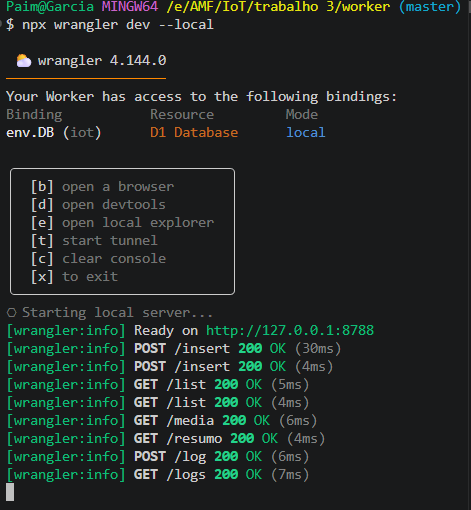
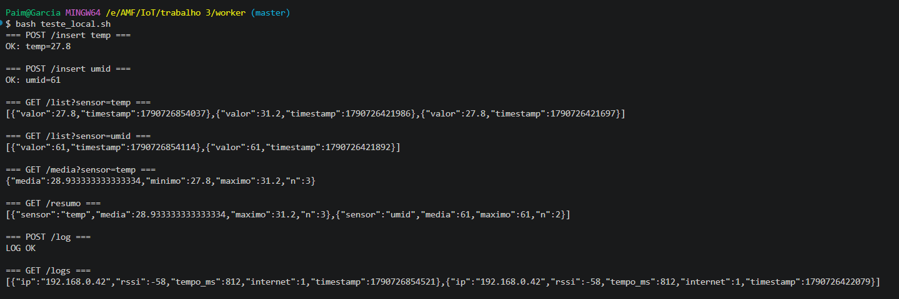

# ENTREGA — Atividade IoT: Estação de sensores na nuvem com Cloudflare D1

## Banco de dados

### 1. Diferença entre KV e D1

O **KV** é um banco **chave-valor**: cada dado é acessado por uma chave única e não existe
noção de "linhas relacionadas" nem de consultas — para responder qualquer pergunta que não seja
"me dê o valor dessa chave", seria preciso listar tudo e calcular no próprio código. O **D1** é
um banco **relacional (SQL, baseado em SQLite)**: os dados ficam organizados em tabelas, com
linhas e colunas, e é possível filtrar, ordenar, agregar e cruzar informações diretamente com
comandos SQL.

**Exemplo de pergunta fácil no D1 e difícil no KV:** "qual foi a temperatura média das últimas
leituras e quantas passaram de 30°C?". No D1 isso é uma única consulta:

```sql
SELECT AVG(valor) AS media, COUNT(*) AS total
FROM leituras
WHERE sensor = 'temp' AND valor > 30;
```

No KV, seria necessário listar todas as chaves do prefixo `sensor:temp:`, buscar o valor de
cada uma e fazer a média/contagem manualmente no Worker.

### 2. O binding `DB`

O **binding `DB`** é a "ligação" configurada em **Settings → Bindings** do Worker que conecta o
código ao banco D1 chamado `iot`. É graças a esse binding que o objeto `env.DB` existe dentro do
`fetch(request, env)` e permite chamar `env.DB.prepare(...)`. Sem esse binding, `env.DB` seria
`undefined`, e qualquer tentativa de chamar `.prepare(...)` nele lançaria um erro em tempo de
execução (`Cannot read properties of undefined`), fazendo o Worker responder com erro 500 em
todas as rotas que dependem do banco.

### 3. As tabelas `leituras` e `conexoes`

**`leituras`** — guarda cada medição enviada pelo ESP32:

| Coluna      | Tipo    | O que guarda                                          |
|-------------|---------|--------------------------------------------------------|
| `id`        | INTEGER | Identificador único da linha, gerado automaticamente.  |
| `sensor`    | TEXT    | Nome do sensor (`"temp"` ou `"umid"`).                 |
| `valor`     | REAL    | O número medido (permite casas decimais).              |
| `timestamp` | INTEGER | Momento da medição, em milissegundos (`Date.now()`).   |

**`conexoes`** — guarda o log de cada ciclo de conexão do dispositivo:

| Coluna      | Tipo    | O que guarda                                              |
|-------------|---------|-------------------------------------------------------------|
| `id`        | INTEGER | Identificador único da linha, gerado automaticamente.      |
| `ip`        | TEXT    | Endereço IP recebido do roteador (`WiFi.localIP()`).        |
| `rssi`      | INTEGER | Força do sinal Wi-Fi em dBm (`WiFi.RSSI()`).                |
| `tempo_ms`  | INTEGER | Tempo, em ms, que o ESP32 levou para conectar ao Wi-Fi.     |
| `internet`  | INTEGER | `1` se a nuvem respondeu ao POST, `0` caso contrário.       |
| `timestamp` | INTEGER | Momento do registro do log, em milissegundos.               |

A **chave primária** (`id`, com `PRIMARY KEY AUTOINCREMENT`) é o identificador único de cada
linha da tabela, numerado automaticamente pelo próprio banco (1, 2, 3…). Ela serve para
distinguir registros mesmo que todos os outros campos sejam iguais, e é usada internamente pelo
SQLite para indexar e localizar linhas rapidamente.

## SQL

### 4. Média da temperatura

```sql
SELECT AVG(valor) AS media
FROM leituras
WHERE sensor = 'temp';
```

### 5. Quantas leituras de temperatura passaram de 30

```sql
SELECT COUNT(*) AS total
FROM leituras
WHERE sensor = 'temp' AND valor > 30;
```

### 6. O que o `GROUP BY sensor` faz no `/resumo`

O `GROUP BY sensor` separa todas as linhas da tabela `leituras` em grupos, um para cada valor
distinto da coluna `sensor` (no nosso caso, `"temp"` e `"umid"`), e aplica as funções de
agregação (`AVG`, `MAX`, `COUNT`) **separadamente dentro de cada grupo**, em vez de sobre a
tabela inteira. Na nossa estação, como enviamos exatamente dois sensores (temperatura e
umidade), o `/resumo` devolve **2 linhas** — uma com a média/máximo/contagem de `temp` e outra
com a de `umid`.

## Dispositivo e conexão

### 7. O que o log de conexão registra

O log de conexão (tabela `conexoes`) registra **IP**, **RSSI**, **tempo de conexão** e
**internet** de cada ciclo. Cada campo ajuda a diagnosticar problemas de um sensor instalado no
campo:

- **IP** — confirma que o ESP32 recebeu um endereço válido do roteador; um IP ausente ou
  repetido pode indicar problema de DHCP na rede.
- **RSSI** — indica a força do sinal Wi-Fi; valores muito negativos (próximos de -85 dBm ou
  piores) sugerem que o dispositivo está longe do roteador ou há obstáculos, o que pode causar
  desconexões frequentes.
- **tempo de conexão (`tempo_ms`)** — se está aumentando ao longo do tempo, pode indicar
  degradação do sinal ou congestionamento na rede.
- **internet** — mostra se, mesmo conectado ao roteador, o dispositivo conseguiu de fato
  alcançar a nuvem; ajuda a separar problemas de rede local de problemas de acesso externo.

### 8. Como o ESP32 calcula o tempo de conexão; o que são IP e RSSI

O ESP32 guarda o valor de `millis()` **antes** de chamar `WiFi.begin(...)` (`t0`) e, assim que
`WiFi.status() == WL_CONNECTED` se torna verdadeiro, lê `millis()` novamente e subtrai:
`tempo = millis() - t0`. Isso dá o tempo, em milissegundos, que o dispositivo levou para se
associar à rede Wi-Fi.

O **IP** (`WiFi.localIP()`) é o endereço lógico que o roteador atribuiu ao ESP32 dentro da rede
local, usado para identificar o dispositivo e permitir que ele envie/receba pacotes. O **RSSI**
(`WiFi.RSSI()`) é a força do sinal Wi-Fi recebido, medida em dBm — quanto mais próximo de 0,
mais forte o sinal (ex.: -55 dBm é um sinal bom; -85 dBm é fraco e sujeito a quedas).

### 9. Conectar ao roteador não é o mesmo que ter internet

Não. O ESP32 pode se associar perfeitamente ao roteador (ganhar IP, RSSI bom, `WL_CONNECTED`) e
mesmo assim não ter saída para a internet — por exemplo, se o roteador estiver sem link com a
operadora. O campo **`internet`** do log distingue as duas situações porque só é marcado como
`1` quando o `POST` feito para o Worker (que está na nuvem, fora da rede local) **recebeu uma
resposta HTTP** (`code > 0`); se a requisição falhar (timeout, sem rota para a internet), o
código continua `0`, mesmo que a conexão Wi-Fi local esteja ativa.

---

## Testes (`wrangler dev --local`)

```
== POST /insert temp ==
OK: temp=27.8

== POST /insert umid ==
OK: umid=61

== POST /insert temp 2 ==
OK: temp=31.2

== POST /log ==
LOG OK

== GET /get?sensor=temp ==
{"valor":31.2,"timestamp":1790726421986}

== GET /list?sensor=temp ==
[{"valor":31.2,"timestamp":1790726421986},{"valor":27.8,"timestamp":1790726421697}]

== GET /list?sensor=umid ==
[{"valor":61,"timestamp":1790726421892}]

== GET /media?sensor=temp ==
{"media":29.5,"minimo":27.8,"maximo":31.2,"n":2}

== GET /resumo ==
[{"sensor":"temp","media":29.5,"maximo":31.2,"n":2},{"sensor":"umid","media":61,"maximo":61,"n":1}]

== GET /logs ==
[{"ip":"192.168.0.42","rssi":-58,"tempo_ms":812,"internet":1,"timestamp":1790726422079}]
```




