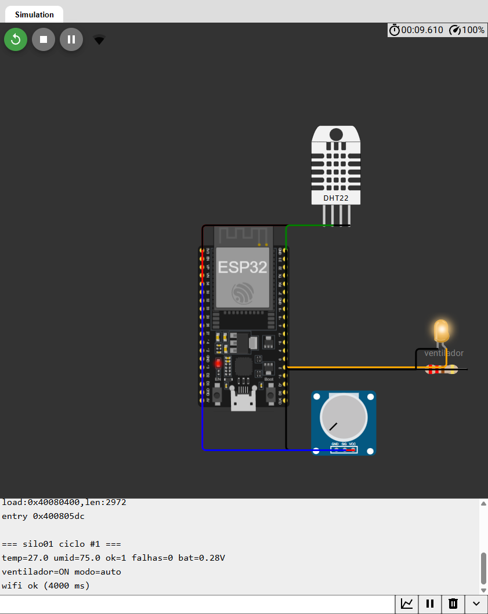
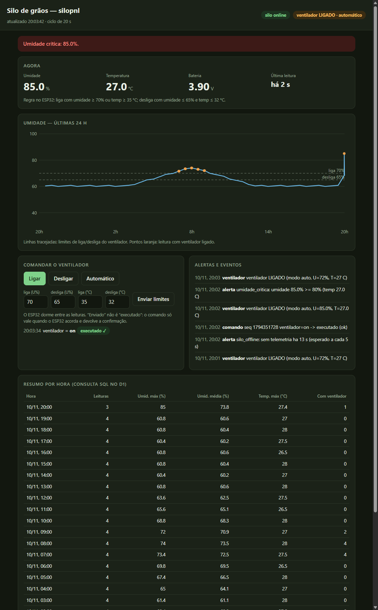

Faculdade Antonio Meneghetti · Sistemas de Informação
IoT (Internet das Coisas) · G0813 · Prof. Leonam V. Hemann · Turma AMF 2026-02

# TRABALHO N2 — CADERNO DE PROJETO

**Silo Vigia: da ideia ao sistema**

| Campo | Resposta |
| :---- | :---- |
| **Integrantes** (papéis: montagem · código · nuvem e painel · caderno e testes) | Yuri Garcia — todos os papéis (trabalho individual) |
| **Desafio escolhido** | A — Silo de grãos |
| **Link do repositório no GitHub** | https://github.com/yurigarciia/iot-internet-of-things |

# ETAPA 0 — ESCOLHA DO DESAFIO

| Campo | Resposta |
| :---- | :---- |
| **Desafio (A) ou ideia própria (B)** | **A — Silo de grãos.** Kit: DHT22 (umidade e temperatura), LED no lugar do ventilador (na prática, um relé), potenciômetro simulando a tensão da bateria. |
| **Por que esse problema importa? Quem ganha? — Frase da ideia** | Grão armazenado úmido ou quente fermenta, cria fungo e perde valor; o silo fica longe da tomada, então o equipamento precisa viver de bateria e decidir sozinho. Ganham o produtor e a cooperativa (menos perda de safra) e quem compra o grão (menos micotoxina). **"Para o produtor rural, que sofre com grão estragando por umidade em silo sem tomada, o Silo Vigia sente umidade e temperatura (DHT22), decide (liga o ventilador com umidade ≥ 70 % ou temperatura ≥ 35 °C, desliga com ≤ 65 % e ≤ 32 °C) e age com o ventilador (relé; LED no kit), mesmo com bateria de 18650 e sem internet."** |

# ETAPA 1 — PROBLEMA E REQUISITOS

| Código | Requisito (o dispositivo deve...) | Como vamos comprovar |
| :---- | :---- | :---- |
| **RF1** | Ligar o ventilador quando umidade ≥ 70 % **ou** temperatura ≥ 35 °C, e desligá-lo só quando umidade ≤ 65 % **e** temperatura ≤ 32 °C, em até 3 s depois de acordar, sem depender de rede. | No Wokwi, mover o DHT22 de 62 % → 75 % → 68 % → 63 % e ver no Serial `ventilador=ON/OFF` no mesmo ciclo (Etapa 10, "No limite"). |
| **RF2** | Entrar em estado seguro quando o sensor falha: manter o estado por 2 leituras inválidas e, na 3ª seguida, **ligar o ventilador** e gerar o alerta `sensor_falha`. | Desconectar o fio SDA do DHT22 no Wokwi; conferir `falhas=3 → ventilador=ON` e o alerta no painel (Etapa 10, "Na falha"). |
| **RF3** | Publicar a cada ciclo (30 min em produção) a telemetria assinada por MQTT/TLS; o histórico deve ser gravado no D1 sem duplicar leituras e responder ao resumo por hora. | `teste_worker.mjs` (leitura duplicada não grava de novo; resumo soma 6 leituras, máx. 74 %); `/resumo` no painel. |
| **RF4** | Executar comandos remotos (ventilador on/off/auto e novos limites) **somente** se tiverem assinatura HMAC válida e número de sequência maior que o último; confirmar com *ack*. O painel só mostra "executado" com o ack; sem ack em 2×ciclo+30 s mostra "sem confirmação". | `teste_ponte.py` (ack assinado → executado; ack forjado não confirma; timeout → `sem_confirmacao`) e `ataque_comando_falso.py` (Etapa 10). |
| **RF5** | Alertar (`umidade_critica` ≥ 80 %, `sensor_falha`, `bateria_baixa` < 3,4 V, `silo_offline` após 2,5 ciclos sem dados) sem repetir o mesmo alerta antes de 30 min. | `teste_worker.mjs` e `teste_ponte.py`: 1º alerta passa, 2º igual é barrado pelo cooldown, tipo diferente passa. |

| Código | Requisito não funcional (como e quanto) | Por que é importante neste problema |
| :---- | :---- | :---- |
| **RNF1** | Autonomia ≥ 300 dias com 2 células 18650 (6.000 mAh) e ciclo de 30 min (cálculo: 350 dias, Etapa 8). | Não há tomada no silo; trocar bateria em silo cheio é perigoso e caro. |
| **RNF2** | Continuar decidindo e agindo sem internet; guardar até 24 leituras e reenviá-las na volta. Wi-Fi com limite de 10 s por ciclo. | O sinal no campo cai; o grão não pode esperar a rede. O limite de 10 s evita gastar bateria procurando Wi-Fi. |
| **RNF3** | Operar em ar úmido e poeirento, faixa do DHT22: −40 a 80 °C e 0 a 100 % UR (±2–5 %). Rejeitar no Worker valores fora da faixa física. | O sensor mede justamente a umidade que causa o problema; leitura absurda não pode contaminar o histórico. |
| **RNF4** | Comunicar só por TLS com certificado conferido; nenhuma mensagem (comando, telemetria, ack) é aceita sem assinatura HMAC; nenhum segredo no GitHub. | Broker público: qualquer um conhece o tópico. Um comando falso poderia desligar o ventilador de um silo úmido. |

# ETAPA 2 — SENTIR E AGIR: COMPONENTES

| Componente | Mede ou aciona o quê | GPIO | Faixa ou limite | Se falhar, o sistema... |
| :---- | :---- | :---- | :---- | :---- |
| **DHT22** (kit físico: DHT11) | Umidade relativa e temperatura do ar dentro do silo (indica o estado do grão). | 4 | 0–100 % UR; −40 a 80 °C. Liga: U ≥ 70 % ou T ≥ 35 °C. Desliga: U ≤ 65 % e T ≤ 32 °C. | Tenta 3 leituras (2,1 s entre elas). Se ainda for NaN: mantém o estado por 2 ciclos e, na 3ª falha seguida, **liga o ventilador** (estado seguro: ventilar gasta pouca energia, grão úmido estraga) e alerta `sensor_falha`. |
| **LED = ventilador** (na prática: relé ou MOSFET + ventilador de 12 V) | Aciona a ventilação do silo. | 2 | Ligado/desligado. Modo manual vale por 8 despertares e volta ao automático. | Durante o sono o pino fica **preso** (`gpio_hold`), então o ventilador segue como estava. Se faltar energia e a placa reiniciar, ele volta desligado e a regra reavalia na 1ª leitura. |
| **Potenciômetro = tensão da bateria** (divisor 1:1 no pino ADC) | Tensão da bateria (V). | 34 (ADC1, que convive com o Wi-Fi) | 3,0–4,2 V. Abaixo de 3,4 V: dorme o dobro e alerta `bateria_baixa`. | Leitura < 0,5 V (sem bateria, ligado por USB) é ignorada: nem dobra o sono nem alerta. |

# ETAPA 3 — ONDE DECIDIR: ESP32 OU NUVEM?

| Campo | Resposta |
| :---- | :---- |
| **Regra de decisão em pseudocódigo** | `a cada despertar:`<br>`  lê DHT (até 3 tentativas)`<br>`  se modo == manual_on  → vent = 1; se manual_off → vent = 0`<br>`  senão se leitura inválida: falhas++; se falhas ≥ 3 → vent = 1  (senão mantém)`<br>`  senão se vent == 0 e (U ≥ 70 ou T ≥ 35) → vent = 1`<br>`       senão se vent == 1 e (U ≤ 65 e T ≤ 32) → vent = 0     ← histerese`<br>`  aplica no pino (e o pino fica preso durante o sono)` |
| **Onde a regra roda e por quê** | **No ESP32 (borda).** (1) Tem que funcionar com a internet fora. (2) O ESP32 dorme quase o tempo todo e a nuvem não consegue "chamá-lo": só ele pode agir no instante em que acorda. (3) A decisão precisa ocorrer em segundos. O que **muda com frequência** (os limites) é ajustável pela nuvem: o painel envia o comando `limites`, o ESP32 guarda na memória não volátil (NVS) e passa a usar. A nuvem decide só o que exige visão externa: alertas, cooldown e o vigia "silo offline". |
| **O que acontece se a internet cair? E quando ela voltar?** | **Cai:** o ESP32 lê, decide e aciona normalmente. O Wi-Fi tem limite de 10 s por ciclo; sem rede ele guarda a leitura numa fila na memória RTC (24 posições, a mais antiga cai se encher) e volta a dormir, sem gastar bateria à toa. A ponte percebe a ausência e emite silo_offline após 2,5 ciclos. **Volta:** no próximo despertar o ESP32 envia primeiro as leituras guardadas (marcadas `atrasada`, com o horário original) e depois a atual; o D1 ignora duplicatas pelo índice único (silo, ts). Se o Worker é que cair, a ponte guarda as gravações numa fila (até 500) e reenvia a cada 10 s. |

# ETAPA 4 — COMUNICAR: PROTOCOLO, TÓPICOS E MENSAGEM

| Campo | Resposta |
| :---- | :---- |
| **Protocolo(s) escolhido(s) e por quê** | **MQTT sobre TLS** entre ESP32 e ponte: publicar/assinar, e a **mensagem retida** resolve o problema do dispositivo que dorme (o comando espera no broker até o ESP32 acordar; basta 1,5 s de rádio, em vez de ficar 5 s acordado esperando). **HTTP (Worker)** entre a ponte e a nuvem: gravar no D1/KV e consultar o histórico. **Polling** HTTP do painel. WebSocket não foi usado (ver Etapa 6). O ESP32 **não fala HTTPS**: menos código e menos superfície de ataque. |
| **Árvore de tópicos** (base sis1a/yuripaim/silo01/) | …/telemetria — ESP32 publica; ponte assina. Uma por ciclo (ou lote, na volta da rede).<br>…/estado — ESP32 publica, **retido**; ponte assina. Limites, modo, bateria baixa, firmware.<br>…/comando — ponte publica, **retido, QoS 1**; ESP32 assina.<br>…/ack — ESP32 publica, **retido**; ponte assina. Resultado do comando.<br>`…/alerta` — ponte publica; quem quiser assina.<br>Para 100 silos: `sis1a/yuripaim/+/telemetria` (um assinante para todos). Minúsculas, sem acento, unidade no campo. |
| **JSON de exemplo da telemetria** | `{"v":1,"silo":"silo01","ts":1794349737,"ciclo":12,"temp_c":27.4,"umid_pct":68.2,"ventilador":0,"modo":"auto","sensor_ok":true,"bat_v":3.92,"rssi":-58,"atrasada":false,"mac":"<HMAC-SHA256 de 64 hex do texto acima>"}` |
| **TLS: qual porta e como o ESP32 confere o servidor?** | Porta **8883**. O ESP32 usa WiFiClientSecure.setCACert() com a **CA do broker** (ca_cert.h, gerada por baixar_ca.py) e valida a cadeia e o nome do servidor; **não existe `setInsecure()`**. Como a validade do certificado depende da data, ele acerta o relógio por NTP antes de conectar; se o NTP falhar, **não conecta** (prefere ficar offline a conectar sem conferir). A ponte usa `ssl.CERT_REQUIRED` com a mesma CA. |

# ETAPA 5 — GUARDAR: O HISTÓRICO

| Campo | Resposta |
| :---- | :---- |
| **KV, D1 ou os dois? Por quê?** | **Os dois.** **D1** guarda o histórico (cada leitura é uma linha; o resumo por hora precisa de GROUP BY, MAX, AVG). **KV** guarda o que é "um valor por chave": o último estado do silo (ultimo:<silo>, para o painel abrir já com dado) e o **cooldown dos alertas** (`cooldown:<silo>:<tipo>`, com `expirationTtl`: a própria chave expira quando o cooldown acaba e sobrevive a reinício da ponte). |
| **Estrutura: tabelas e colunas, ou chaves** | **D1 leituras:** `id, silo, ts (ms), temp_c, umid_pct, ventilador, sensor_ok, bat_v, rssi, atrasada, recebido_ts` + índice único `(silo, ts)` (evita duplicar). **D1 eventos:** `id, silo, ts, tipo (ventilador/comando/alerta/seguranca), detalhe`. **KV:** `ultimo:<silo>`, `cooldown:<silo>:<tipo>`. |
| **De quanto em quanto tempo grava?** | A cada despertar do ESP32: **30 min em produção** (48 linhas/dia por silo; a umidade do grão muda em horas, e ciclos curtos gastam bateria) e 30 s na demonstração. Eventos (mudança de ventilador, comando, alerta) são gravados na hora em que ocorrem. |
| **Consulta de resumo (SQL) e a pergunta que ela responde** | *Qual foi a umidade máxima e média em cada hora das últimas 24 h, e em quantas leituras o ventilador estava ligado?*<br>`SELECT strftime('%Y-%m-%dT%H:00:00Z', ts/1000, 'unixepoch') AS hora, COUNT(*) AS leituras, ROUND(MAX(umid_pct),1) AS umid_max, ROUND(AVG(umid_pct),1) AS umid_media, ROUND(MAX(temp_c),1) AS temp_max, SUM(ventilador) AS leituras_com_ventilador FROM leituras WHERE silo=? AND ts>=? AND sensor_ok=1 GROUP BY hora ORDER BY hora` (rota `GET /resumo`). |
| **Por quanto tempo guardar? Há dado pessoal?** | **30 dias** (RETENCAO_DIAS); o Worker apaga o que for mais antigo a cada gravação. **Não há dado pessoal**: só grandezas físicas e o identificador do silo. Se o produto passar a registrar quem entra no silo, valem a LGPD: guardar só o necessário, pelo tempo necessário. |

# ETAPA 6 — MOSTRAR E COMANDAR: O PAINEL

| Campo | Resposta |
| :---- | :---- |
| **O que o painel mostra** | Umidade, temperatura e bateria atuais; há quanto tempo foi a última leitura; chips "silo online / SEM COMUNICAÇÃO" e "ventilador ligado/desligado · modo"; faixa vermelha em umidade crítica ou sensor inválido; gráfico de umidade das últimas 24 h com os limites e os pontos com ventilador ligado; tabela do resumo SQL por hora; lista de alertas e eventos; comandos enviados e seus estados. |
| **Comando remoto: qual, por qual tópico ou rota** | ventilador = on / off / auto e limites = ligaU,desligaU,ligaT,desligaT. O painel faz POST /comando na **ponte** local (token próprio); a ponte valida, **assina** (HMAC-SHA256 sobre seq\|cmd\|valor, com seq = max(hora Unix, último+1)) e publica retido em sis1a/yuripaim/silo01/comando. A chave HMAC **nunca** vai ao navegador. |
| **Como o painel sabe que o comando foi executado? Quanto tempo espera?** | O ESP32 acorda, recebe o comando retido, confere assinatura e sequência, aplica e publica o **ack** assinado (ok, motivo, estado final). A ponte confere a assinatura do ack e marca o comando como **executado** (ou **rejeitado**). Até lá o painel mostra "enviado — aguardando o ESP32 acordar". Espera no máximo **2 × ciclo + 30 s** (o ciclo pode estar dobrado por bateria baixa); depois mostra "**sem confirmação (ESP32 offline?)**", nunca "executado". |
| **Alerta: quando dispara, por onde chega e qual o cooldown** | Dispara (na ponte, a cada telemetria autêntica): umidade ≥ 80 %, sensor inválido, bateria < 3,4 V, ou silo sem dados por mais de 2,5 ciclos. Chega pelo tópico …/alerta, pela tabela de eventos do D1 e pelo painel (faixa e lista). **Cooldown de 30 min por tipo**: antes de avisar, a ponte pergunta ao Worker (`POST /alerta/tentar`); o KV guarda a chave com TTL e responde `permitido: false` enquanto ela existir. Tipos diferentes não se bloqueiam. |
| **Polling ou WebSocket? Por quê?** | **Polling**: 4 s no estado da ponte (para o ack aparecer logo) e 30 s no histórico. O ESP32 só fala a cada 30 min; uma conexão WebSocket aberta o tempo todo não traria dado novo. O Extra escolhido é energia (Etapa 8), não tempo real. |

# ETAPA 7 — PROTEGER: SEGURANÇA

| Buraco | Existe no nosso sistema? | Como fechamos (camada) |
| :---- | :---- | :---- |
| **1. MQTT sem TLS (porta 1883)** | Não. | **Rede:** só a porta 8883. ESP32 confere a CA do broker (`setCACert`) e a ponte usa `CERT_REQUIRED`; sem hora válida o ESP32 nem conecta. |
| **2. setInsecure() no HTTPS** | Não. | **Dispositivo:** o ESP32 não faz HTTPS (só MQTT/TLS conferido). A ponte usa `requests`, que valida o certificado; em desenvolvimento ela fala `http://127.0.0.1` (loopback). Ao publicar o Worker, `WORKER_URL` passa a `https://`. |
| **3. Rota de gravação aceita qualquer um** | Existia no Trabalho 3 (Worker sem autenticação). Aqui foi fechada. | **Nuvem:** toda rota exige Authorization: Bearer; dois tokens separados (escrita para a ponte, leitura para o painel); comparação em tempo constante; sem tokens configurados o Worker **falha fechado** (500); validação de silo e de faixa física; `INSERT OR IGNORE` contra duplicata. 25 verificações automáticas, incluindo 401 sem token, com token errado e com token de leitura em rota de escrita. |
| **4. Tópico de comando aberto** | **Sim — o broker é público**: qualquer um pode publicar no tópico. | **Aplicação:** o comando só vale com HMAC-SHA256 válido **e** seq maior que o último (anti-replay, guardado em NVS; só avança com comando autêntico). A ponte só assina cmd/valor da lista permitida e o ESP32 valida faixas de novo. Telemetria, estado e ack **também** são assinados: a ponte descarta e registra (`seguranca`) o que não confere. Limite honesto: TLS não esconde os dados do broker nem de quem assina o tópico; para sigilo ou ACL por dispositivo seria preciso um broker próprio com usuário/senha. |
| **5. Segredo no GitHub ou no Serial** | Risco existia (Wi-Fi, chave, tokens). | **Repositório e Serial:** `config.h`, `servico/.env`, `worker/.dev.vars` e `seq.json` estão no `.gitignore`; só os arquivos `*.example` são versionados. No Worker, tokens são *secrets* do ambiente. O firmware nunca imprime `HMAC_KEY` nem a senha do Wi-Fi. No Wokwi, usar chave de teste. Limite: o painel guarda os tokens no `localStorage` do navegador (uso local). |

# ETAPA 8 — EXTRA: ENERGIA E AUTONOMIA

| Campo | Resposta |
| :---- | :---- |
| **Extra escolhido e por que combina com o problema** | **Energia e autonomia.** O silo não tem tomada, e a "decisão mais difícil" do desafio é quanto tempo o ESP32 pode ficar acordado. Decisões que reduzem o consumo: deep sleep entre ciclos; Wi-Fi com teto de 10 s; comando **retido** (1,5 s de rádio em vez de 5 s de espera); ventilador preso por `gpio_hold` (não precisa acordar para mantê-lo); sono dobrado com bateria < 3,4 V. |
| **Evidência (cálculo, print ou comparação)** | **Premissas** (valores típicos de datasheet, **não medidos**; confirmar com multímetro em série): acordado 8,5 s por ciclo — 2,5 s a 45 mA (boot + DHT), 3 s a 130 mA (Wi-Fi + NTP), 3 s a 140 mA (TLS + MQTT + comando) —; sono 0,06 mA (ESP32 10 µA + DHT22 em standby); bateria 2 × 18650 de 3.000 mAh em paralelo, 80 % úteis = 4.800 mAh. Ventilador em alimentação própria.<br>**Corrente média = Σ(corrente × tempo) ÷ período.** Carga por despertar = (2,5·45 + 3·130 + 3·140) ÷ 3600 = **0,256 mAh**. Para 30 min: (0,256 + 1791,5·0,06÷3600) × 3600 ÷ 1800 = **0,572 mA**. **Autonomia = 4.800 ÷ 0,572 = 8.390 h ≈ 350 dias.**<br>python docs/autonomia.py: sem deep sleep (Wi-Fi sempre ligado, ~80 mA) → **2 dias**; ciclo de 30 s (demo) → 6 dias; 15 min → **184 dias**; 30 min → **350 dias**; 60 min → **633 dias**.<br>**Comparação de projeto:** ficar 5 s acordado esperando comando (como no Trabalho 4) gasta **34 % mais** corrente média (0,767 mA contra 0,572 mA) que a janela de 1,5 s com mensagem retida.<br>**Conclusão:** o requisito RNF1 (≥ 300 dias) é atendido com ciclo de 30 min; para 1 ano completo, usar 60 min ou reduzir o tempo de Wi-Fi (IP fixo, canal e BSSID guardados na RTC). |

# ETAPA 9 — ARQUITETURA FINAL

| Camada | O que tem nela no nosso sistema |
| :---- | :---- |
| **Dispositivo** | ESP32 + DHT22 (GPIO 4) + LED/relé do ventilador (GPIO 2, preso no sono) + divisor da bateria (GPIO 34). Firmware silo.ino: lê, **decide**, aciona, comunica e dorme. Memória RTC (estado, fila de 24 leituras) e NVS (limites e último `seq`). Bateria 2 × 18650. |
| **Rede** | Wi-Fi → **MQTT sobre TLS 8883** no broker (`test.mosquitto.org` no desenvolvimento) com tópicos `sis1a/<grupo>/<silo>/…`, mensagens retidas e assinatura HMAC. HTTP(S) com token entre a ponte e o Worker. |
| **Nuvem** | **Ponte** (ponte.py): confere assinaturas, grava, alerta, vigia, assina comandos. **Cloudflare Worker** (worker.js) com **D1** (histórico, eventos) e **KV** (último estado, cooldown). Local com `wrangler dev --local`; publicável sem mudar o código. |
| **Interface** | **Painel** `index.html`: estado, gráfico de 24 h, resumo SQL, alertas, comando com confirmação. Fala com a ponte (estado e comando) e com o Worker (histórico). |

```
 ┌────────────── DISPOSITIVO ──────────────┐        ┌──── REDE ────┐       ┌──────────────── NUVEM ────────────────┐       ┌── INTERFACE ──┐
 │ DHT22 ─┐                                │        │              │       │                                       │       │               │
 │ pot(bat)┼─ ESP32: lê → DECIDE → aciona  │ MQTT   │   broker     │ MQTT  │  ponte.py ── HTTP + token ──► Worker  │ HTTP  │  painel       │
 │        └─►  (histerese, estado seguro)  ├─TLS───►│ (retido, QoS)├─TLS──►│  • confere HMAC     ┌─ D1: leituras   │◄─────►│  index.html   │
 │ LED/relé ◄─ gpio_hold no sono           │ 8883   │              │       │  • alerta+cooldown  │   eventos       │ token │  polling 4/30s│
 │ RTC: fila offline · NVS: limites, seq   │◄───────┤  …/comando   │◄──────┤  • assina comando   └─ KV: último,    │       │               │
 └─────────────────────────────────────────┘ retido └──────────────┘ HMAC  └───────────────────────────cooldown ──┘       └───────────────┘
```

| Desenho ou print do sistema | Print do Wokwi em wokwi_circuito.png e do painel em painel_teste.png (abaixo). |
| :---- | :---- |





# ETAPA 10 — TESTES ANTES DE APRESENTAR

Legenda: **PASS** = executado e verificado. Os testes no hardware real (placa física, sono de verdade) não foram feitos.

| Teste | Como fizemos | Resultado |
| :---- | :---- | :---- |
| **Isolado: cada peça sozinha** | Worker: teste_worker.mjs contra o wrangler dev local. Ponte: teste_ponte.py com mensagens injetadas. Painel: Chrome headless (Selenium). Firmware: compilado para ESP32 e executado no Wokwi, lendo o DHT22, acionando o LED e publicando por MQTT/TLS. | Worker **25/25 PASS**. Ponte **15/15 PASS**. Painel **15/15 PASS**. Firmware no Wokwi: **PASS** (Wi-Fi, NTP, TLS com a CA conferida e telemetria assinada recebida e aceita pela ponte). |
| **No limite: forçar o sensor** | Wokwi, mudando o DHT22 no diagrama e reiniciando a simulação. | Umidade 75 % → `ventilador=ON`; 63 % → `OFF`. Temperatura 36 °C com umidade 62 % → `ON`; 31 °C → `OFF`. **PASS.** A histerese (68 % mantém ligado) não pôde ser comprovada no Wokwi, que apaga a memória a cada reinício da simulação; fica coberta pela regra do código. |
| **Na falha: tirar o sensor ou o Wi-Fi** | Wokwi: desconectar o fio SDA do DHT22. Worker fora do ar com a ponte rodando. | Sem sensor: `falhas=1` e `2` mantêm o estado; na 3ª, `ventilador=ON` e a ponte emite o alerta `sensor_falha`; com o sensor de volta, `OFF`. **PASS.** Worker fora: a ponte guarda a leitura na fila e reenvia na volta: **PASS**. Wi-Fi e fila na RTC: não testados (o Wokwi não preserva a RTC). |
| **No reinício: tirar e ligar o USB** | Comando `ventilador=on` enviado pelo painel, depois reinícios sucessivos da placa no Wokwi. | Estado do ventilador, modo manual, falhas e último `seq` vêm da NVS: o modo `manual_on` e o `seq` sobreviveram aos reinícios e o comando retido **não** foi reaplicado ("já visto"). **PASS.** |
| **No ataque: comando falso** | `ataque_comando_falso.py` com 14 s entre os ataques (sem mac, mac inventado, limites absurdos, `seq` gigante), com o firmware rodando no Wokwi. Também: telemetria e ack forjados, e `POST /ingest` sem token, com token errado e com token de leitura. | O firmware registrou `REJEITADO: assinatura invalida` para os 4 ataques e o ventilador não mudou. Telemetria e ack forjados foram descartados pela ponte. `/ingest` sem token, errado ou de leitura → 401. Ponta a ponta com o broker real (e2e_broker.py, 11 verificações). **PASS.** |
| **Na duração: 10 min ligado** | Firmware no Wokwi com a ponte e o Worker por mais de 10 minutos acumulados nas sessões de teste, sem travar. | Sem travamento e sem leituras duplicadas no D1 (índice único). **PASS.** O Wokwi reinicia a placa em ~12 s em vez de dormir 30 s, então o ciclo real de sono não foi medido. |

# ETAPA 11 — APRESENTAÇÃO E ENTREGA

## Roteiro da apresentação (4 minutos)

1. **Problema e quem usa:** a frase da ideia (Etapa 0).
2. **Arquitetura:** do DHT22 ao painel, em quatro camadas (Etapa 9).
3. **Escolhas:** decide na borda (o ESP32 dorme e a nuvem não o chama); MQTT/TLS com comando retido; D1 para o histórico e KV para estado e cooldown; HMAC porque o broker é público.
4. **Demonstração ao vivo:** subir a umidade no Wokwi → o LED liga; mandar "desligar" pelo painel → "enviado, aguardando" → "executado ✓" quando o ESP32 acorda; rodar o ataque e mostrar a rejeição.
5. **O que falta para virar produto:** broker próprio com ACL por dispositivo; medir a corrente real e otimizar o Wi-Fi; relé e fonte do ventilador; caixa vedada para poeira; provisionamento de 1.000 silos (um segredo HMAC por dispositivo) e `+` nos tópicos.

**Respostas prontas:** *"E se a internet cair?"* — o ESP32 decide sozinho, guarda 24 leituras e reenvia na volta; a ponte avisa `silo_offline`. *"E se alguém publicar no seu tópico?"* — sem HMAC e sequência válidos, o ESP32 ignora; telemetria falsa a ponte descarta. *"E com 1.000 unidades?"* — tópicos com `+`, uma chave por silo, e a ponte vira um consumidor de fila.

## Checklist de entrega (até 24/11)

| | Item |
| :---- | :---- |
| ☐ | Este caderno preenchido (.docx ou PDF) na pasta `docs/` do repositório e no Classroom |
| ☑ | Código do ESP32 e do Worker no GitHub, sem senhas nem chaves (`.gitignore` + arquivos `*.example`) — **conferir git status antes do push** |
| ☑ | README curto: o que o sistema faz, como montar e como testar |
| ☐ | Print ou vídeo curto do sistema funcionando (para o caso de falhar na hora) |
